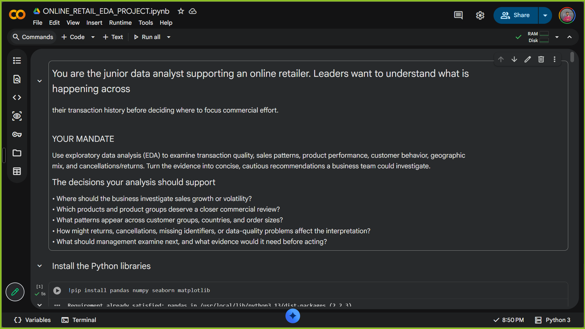
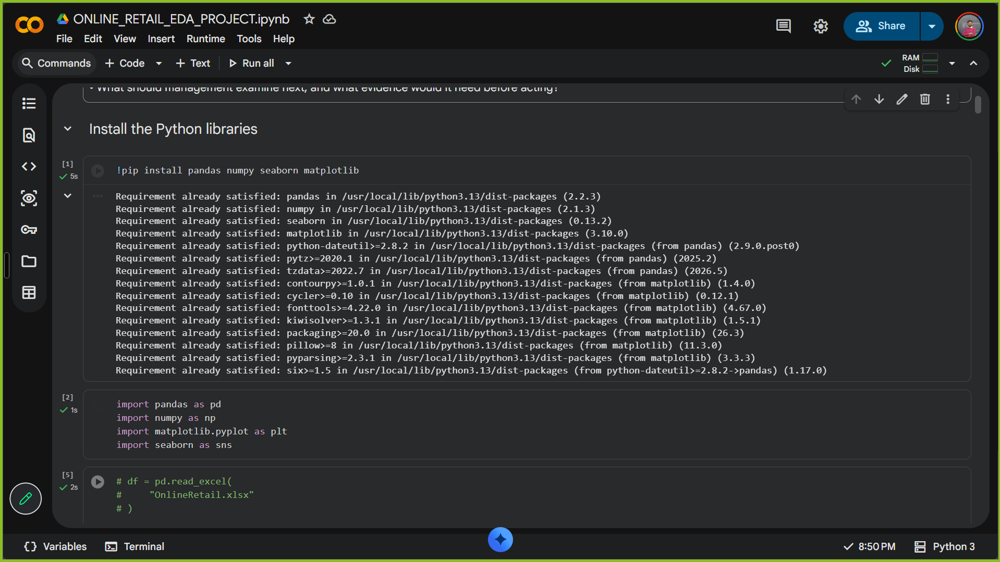
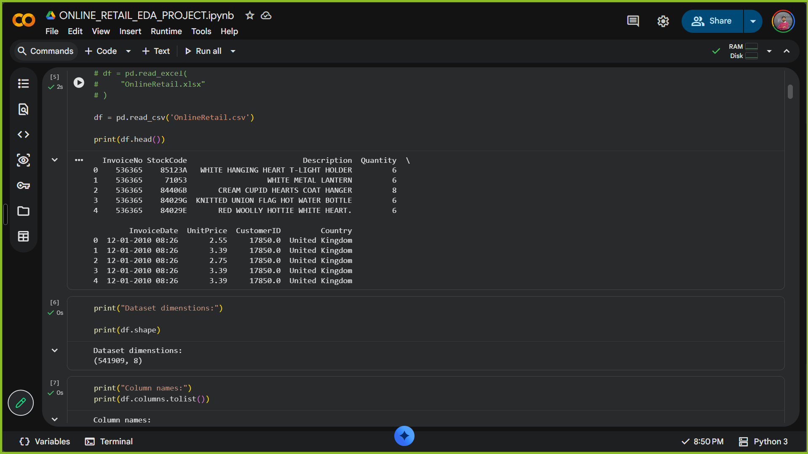
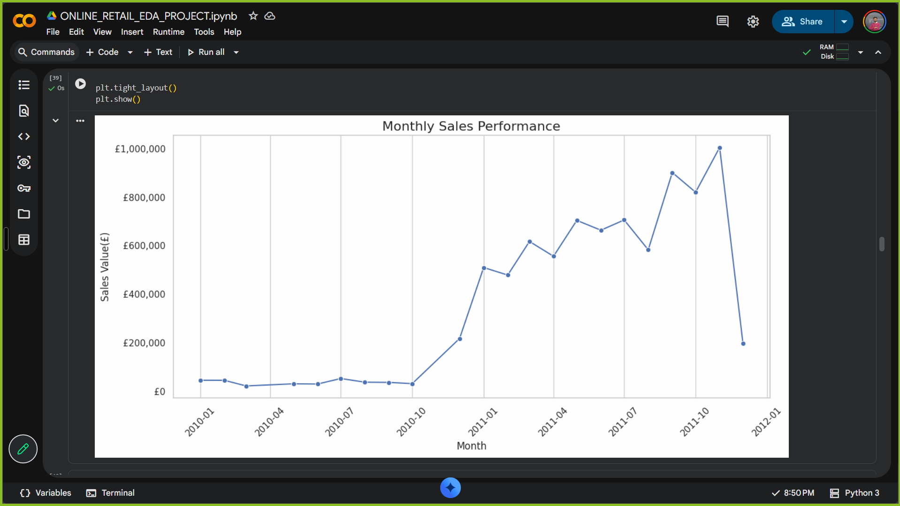
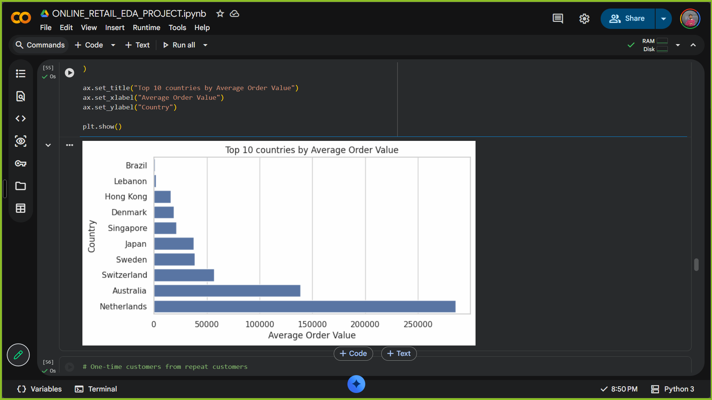

# Retail EDA Project

An exploratory analysis of online retail transactions using Python. The notebook reviews data quality, sales over time, product and customer activity, country-level patterns, and cancellations and returns.

## Project overview

The goal is to explore the transaction history and highlight patterns that a retail team may want to investigate further. The analysis includes:

- Checking missing values and transaction dates
- Preparing the data for analysis, including reviewing missing customer IDs
- Exploring monthly sales and product performance
- Comparing customer and country-level activity
- Considering how cancellations, returns, and data-quality issues affect interpretation

The analysis is exploratory. The patterns are intended to guide further investigation, not to establish causes or make definitive business recommendations.

## Dataset

`OnlineRetail.csv` contains 541,909 transaction records and eight fields: invoice number, stock code, product description, quantity, invoice date, unit price, customer ID, and country.

The dataset is included in this repository. Keep it in the project root so the notebook can load it.





## Analysis and visuals

The notebook uses pandas for data handling and Matplotlib and Seaborn for charts. The monthly sales chart shows how recorded sales change over the period covered by the data.





The country comparison below shows the notebook's top 10 countries by average order value.



## Run the notebook

1. Install Python and Jupyter Notebook, or open the notebook in Google Colab.
2. Install the required libraries:

   ```bash
   pip install pandas numpy seaborn matplotlib
   ```

3. Keep `OnlineRetail.csv` in the project root.
4. Open and run [`ONLINE_RETAIL_EDA_PROJECT.ipynb`](ONLINE_RETAIL_EDA_PROJECT.ipynb).

## Project files

- [`ONLINE_RETAIL_EDA_PROJECT.ipynb`](ONLINE_RETAIL_EDA_PROJECT.ipynb) — analysis notebook
- [`OnlineRetail.csv`](OnlineRetail.csv) — transaction data
- `project_images/` — notebook screenshots used in this README

## Author

Ankit Kumar
